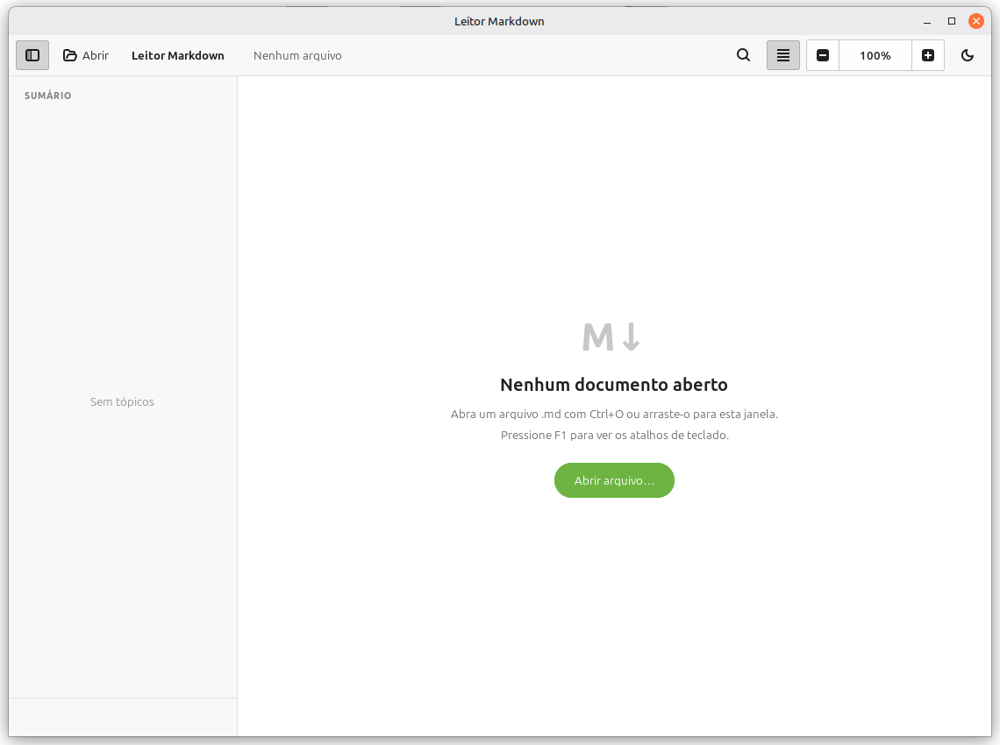
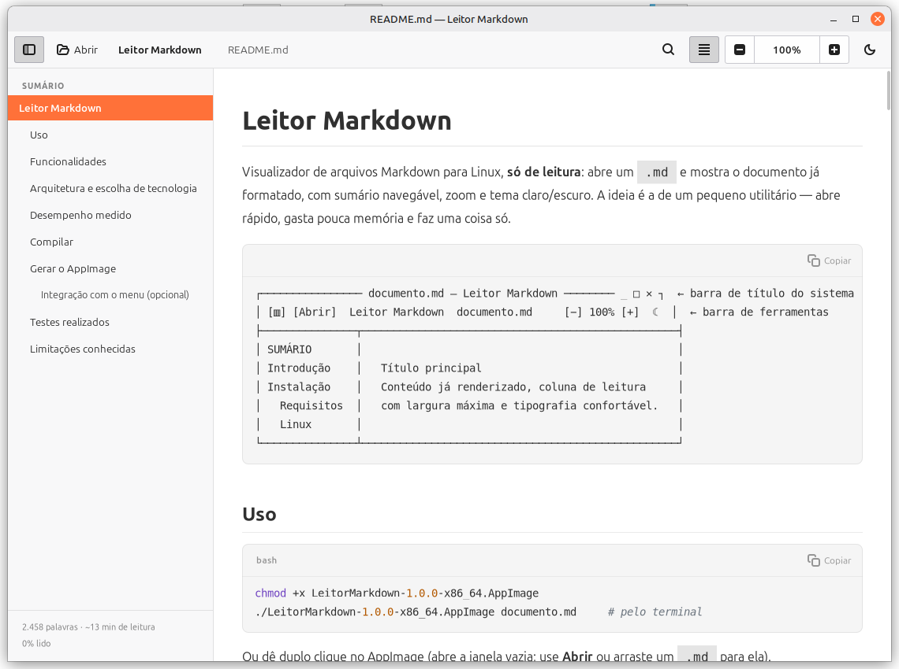
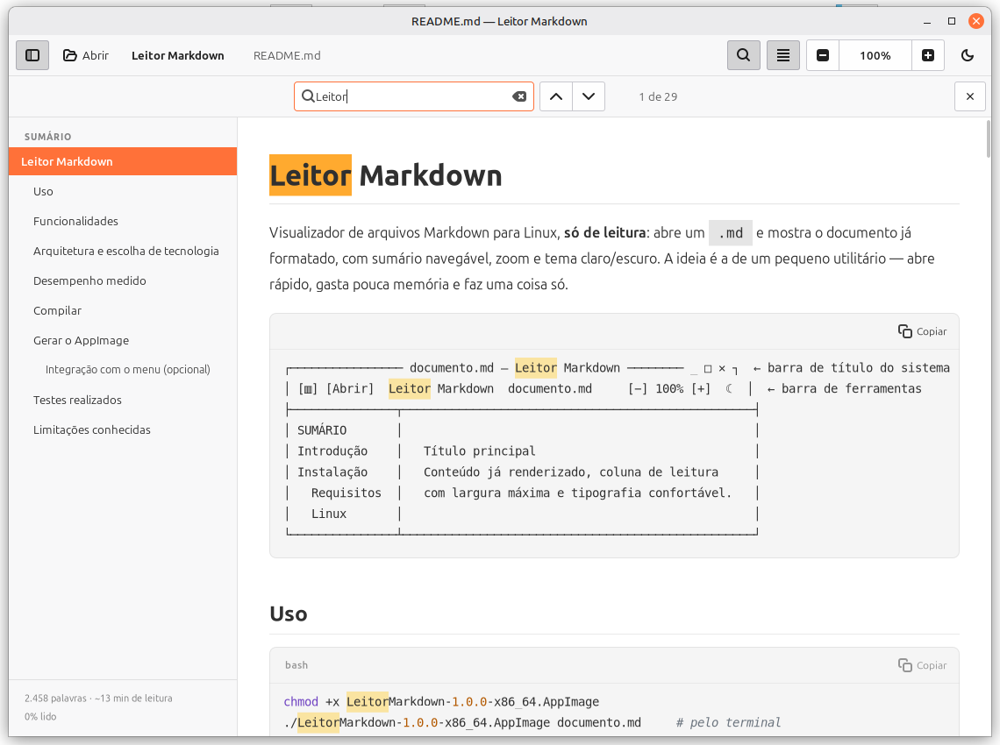
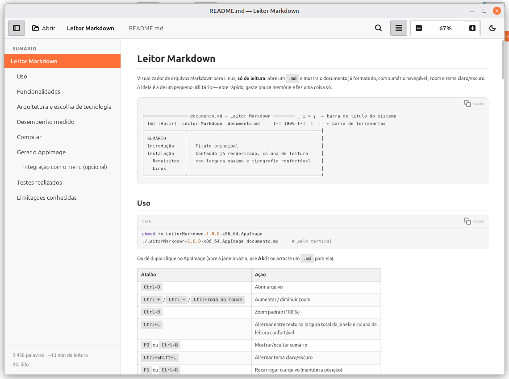
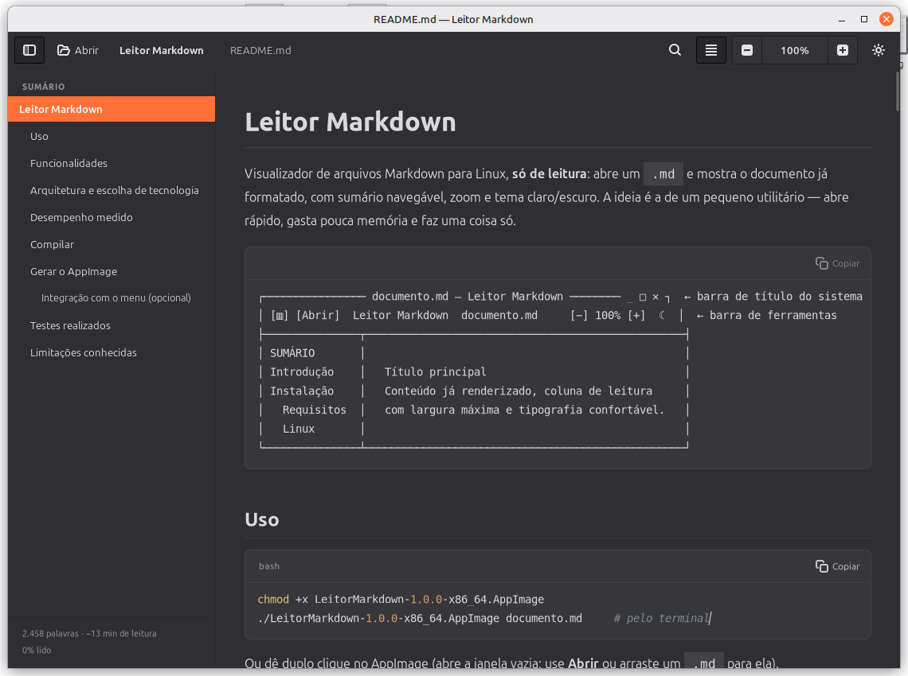

# Leitor Markdown

Visualizador de arquivos Markdown para Linux, **só de leitura**: abre um `.md` e mostra o documento já formatado, com sumário navegável, zoom e tema claro/escuro. A ideia é a de um pequeno utilitário — abre rápido, gasta pouca memória e faz uma coisa só.

```
┌──────────────── documento.md — Leitor Markdown ──────── _ □ ✕ ┐  ← barra de título do sistema
│ [▥] [Abrir]  Leitor Markdown  documento.md     [−] 100% [+]  ☾  │  ← barra de ferramentas
├───────────────┬──────────────────────────────────────────────────┤
│ SUMÁRIO       │                                                  │
│ Introdução    │   Título principal                               │
│ Instalação    │   Conteúdo já renderizado, coluna de leitura     │
│   Requisitos  │   com largura máxima e tipografia confortável.   │
│   Linux       │                                                  │
└───────────────┴──────────────────────────────────────────────────┘
```

### Capturas de tela

**Janela inicial, sem documento aberto**



**Documento aberto, com o sumário navegável à esquerda**



**Busca no documento (`Ctrl+F`), com as ocorrências destacadas**



**Zoom reduzido (67 %)**



**Tema escuro**



## Uso

```bash
chmod +x LeitorMarkdown-1.0.0-x86_64.AppImage
./LeitorMarkdown-1.0.0-x86_64.AppImage documento.md     # pelo terminal
```

Ou dê duplo clique no AppImage (abre a janela vazia; use **Abrir** ou arraste um `.md` para ela).

| Atalho | Ação |
|---|---|
| `Ctrl+O` | Abrir arquivo |
| `Ctrl +` / `Ctrl −` / `Ctrl+roda do mouse` | Aumentar / diminuir zoom |
| `Ctrl+0` | Zoom padrão (100 %) |
| `Ctrl+L` | Alternar entre texto na largura total da janela e coluna de leitura confortável |
| `F9` ou `Ctrl+B` | Mostrar/ocultar sumário |
| `Ctrl+Shift+L` | Alternar tema claro/escuro |
| `F5` ou `Ctrl+R` | Recarregar o arquivo (mantém a posição) |
| `Ctrl+F` | Buscar no documento |
| `Enter` / `F3` / `Ctrl+G` | Próxima ocorrência |
| `Shift+Enter` / `Shift+F3` / `Ctrl+Shift+G` | Ocorrência anterior |
| `Esc` | Fechar a busca |
| `F1` | Lista de atalhos |
| `Espaço`, `PgDn` / `Shift+Espaço`, `PgUp` | Página seguinte / anterior |
| `Home` / `End`, `↑` / `↓` | Início / fim, rolar linha |
| `Ctrl+W` / `Ctrl+Q` | Fechar janela / sair |

Abrir outro arquivo enquanto o leitor já está aberto cria uma nova janela no mesmo processo (a segunda chamada termina em ~20 ms e não carrega o GTK de novo).

## Funcionalidades

- **Markdown completo (CommonMark + GFM)**: títulos, parágrafos, ênfase, tachado, listas (aninhadas, numeradas e de tarefas), citações, alertas do GitHub (`> [!NOTE]`…), tabelas com alinhamento, blocos de código, código inline, links, imagens, notas de rodapé, linhas horizontais, front matter YAML (ignorado), HTML simples (``, `<br>`, `<kbd>`, `<sub>`, `<sup>`, `<h1>`…).
- **Sumário** gerado dos títulos (H1–H6, inclusive `<h1>` em HTML), com hierarquia, clique com rolagem suave e destaque do tópico atual durante a leitura.
- **Largura do texto**: por padrão o texto ocupa toda a largura da janela (inclusive maximizada). `Ctrl+L` ou o botão da barra alternam para uma coluna centralizada de largura confortável, que acompanha o zoom; a posição de leitura é mantida.
- **Zoom** de 50 % a 400 % só na área de leitura; a coluna de texto acompanha o zoom (sem linhas longas demais).
- **Integrado ao visual do Linux Mint**: usa o tema GTK do sistema (Mint-Y, Mint-L, Mint-X… quando têm versão GTK4), os ícones do tema de ícones do sistema e a barra de título nativa do Cinnamon, com uma barra de ferramentas comum logo abaixo.
- **Tema claro/escuro** acompanhando o tema do sistema. O botão ☾/☀ troca para a variante correspondente (ex.: `Mint-Y-Aqua` ↔ `Mint-Y-Dark-Aqua`). Se o tema do sistema não tiver versão GTK4, o leitor usa o tema embutido do GTK e segue a preferência claro/escuro do portal XDG.
- **Destaque de sintaxe** para cerca de 20 famílias de linguagens (Rust, Python, JS/TS, C/C++, Java/Kotlin/C#, Go, Shell, SQL, JSON, YAML/TOML, HTML/XML, CSS, Ruby, PHP, Lua, Dockerfile, diff…).
- **Copiar código**: cada bloco de código tem um botão "Copiar" no canto superior direito (discreto; fica nítido ao passar o mouse sobre o bloco, com cursor de mão), que copia o código exatamente como está no arquivo e confirma com "✓ Copiado!".
- **Progresso de leitura**: barra fina sob a barra de ferramentas e, no rodapé do sumário, número de palavras, tempo estimado de leitura e percentual lido. Um botão flutuante leva de volta ao início.
- **Recarga automática**: quando o arquivo é salvo por outro programa (editor de texto), o leitor recarrega sozinho, mantém a posição de leitura e mostra "· atualizado" ao lado do nome por um instante.
- **Busca no texto** (`Ctrl+F` ou botão da lupa): ignora maiúsculas e acentos ("acao" encontra "Ação"), destaca todas as ocorrências, marca a atual e mostra "n de total"; começa pela primeira ocorrência a partir do trecho que você está lendo.
- **Links**: externos abrem no navegador padrão; `#âncoras` rolam até a seção; links relativos para outros `.md` abrem no próprio leitor (inclusive `outro.md#secao`).
- **Imagens locais** PNG, JPEG, GIF, SVG, WebP, TIFF, BMP — reduzidas para caber na coluna. Seleção e cópia de texto com o mouse.
- UTF-8 (com ou sem BOM; bytes inválidos são substituídos, nunca travam a abertura).

## Arquitetura e escolha de tecnologia

**Rust + GTK4 nativo, sem navegador embutido.** O Markdown é analisado pelo `pulldown-cmark` e cada bloco vira um widget GTK leve.

```
src/
├── main.rs       aplicação, atalhos, opções de linha de comando
├── window.rs     janela: barra superior, sumário, rolagem, zoom, links
├── render.rs     Markdown → widgets (GtkLabel com markup Pango, GtkGrid…)
├── highlight.rs  destaque de sintaxe (analisador léxico próprio)
├── theme.rs      tema claro/escuro (portal XDG + alternância manual)
├── hscroll.rs    rolagem horizontal para tabelas largas
├── imagerow.rs   linha de imagens que encolhem para caber na coluna
└── style.css     tipografia e espaçamento (tudo em "em": o zoom escala tudo)
data/             ícone (SVG/PNG) e arquivo .desktop
scripts/          build-appimage.sh e AppRun
exemplos/         documentos de teste
```

Por que esta combinação:

| Alternativa | Por que não |
|---|---|
| Electron / Chromium embutido | 150–300 MB de RAM, executável de 100+ MB. Vetado pelo requisito. |
| WebKitGTK (renderizar HTML) | É um navegador completo: processos auxiliares, ~100 MB a mais de RAM, e embarcar WebKit num AppImage é frágil e pesado (~60 MB+). |
| GtkTextView com tags | Leve, mas tabelas e imagens viram "widgets ancorados" difíceis de alinhar; o resultado visual fica pior. |
| **Widgets GTK nativos (escolhido)** | Tabela é uma `GtkGrid`, código é um rótulo monoespaçado, imagem é uma `GtkPicture`. Usa só o que o GTK4 já carrega. |

- **GTK4** (e não GTK3): renderização moderna, `FileDialog` nativo, CSS com unidades `em` (zoom proporcional trivial), e é a versão do Linux Mint 22 (4.14).
- **Rust**: binário nativo sem runtime, seguro e de fácil manutenção; o executável tem **~1 MB**.
- **pulldown-cmark**: parser CommonMark maduro e muito rápido (usado pelo `rustdoc`/`mdBook`), puro Rust.
- **Destaque de sintaxe próprio**: a primeira versão usava `syntect` (gramáticas do Sublime); medido, custava **~40 MB de RAM e ~100 ms** na abertura. Foi trocado por um analisador léxico genérico (palavras-chave, strings, comentários, números, tipos, chamadas) — custo praticamente zero.
- **Renderizador Cairo por padrão**: para texto, é rápido o bastante e economiza ~50 MB em relação ao OpenGL. Quem preferir GPU: `GSK_RENDERER=ngl ./LeitorMarkdown…AppImage`.
- **Seleção de texto sob demanda**: rótulos selecionáveis custam memória; um único controlador ativa a seleção apenas no parágrafo sob o ponteiro (−20 % de RAM e de tempo em documentos grandes).

## Desempenho medido

Ambiente de teste: Ubuntu 24.04 (mesma base do Mint 22), GTK 4.14.5, X11 virtual, renderizador Cairo.

| Cenário | Resultado |
|---|---|
| Executável | 1,0 MB |
| AppImage | 25 MB (com GTK4, Pango, Cairo, librsvg, carregadores de imagem) |
| Janela vazia desenhada | ~0,15 s |
| Primeiro quadro com documento de 12 KB (README) | ~0,20 s (análise do Markdown: ~5 ms) |
| Memória, documento de exemplo, sistema mínimo (só fontes DejaVu) | RSS ~45–52 MB |
| Memória, documento de exemplo, sistema com muitas fontes | RSS ~115 MB (PSS ~89 MB; privada ~33 MB — o resto são bibliotecas e fontes compartilhadas) |
| Documento grande (1,1 MB, 13 mil linhas, 800 títulos, 200 tabelas e blocos de código) | primeiro quadro em ~0,3 s; sumário completo desde o início; o restante entra em segundo plano com a janela respondendo |
| Rolagem, documento pequeno ou grande | 60 quadros por segundo (17 ms por quadro) |
| Segunda chamada com o leitor já aberto | ~20 ms |

O RSS inclui páginas de bibliotecas e fontes compartilhadas com outros programas GTK; a memória privada é bem menor.

Para medir na sua máquina (o leitor fecha sozinho logo após desenhar a janela):

```bash
time LEITOR_MD_BENCH=1 LEITOR_MD_DEBUG=1 ./LeitorMarkdown-1.0.0-x86_64.AppImage arquivo.md
```

`janela pronta em … ms` é o tempo até o primeiro quadro; o `real` do `time` inclui também a montagem do AppImage.

Para ver a fluidez (intervalo entre quadros), use `LEITOR_MD_FRAMES=1`.

Otimizações (medidas, antes → depois, na versão 1.0 desta máquina):

| O quê | Antes | Depois |
|---|---|---|
| Primeiro quadro, README de 12 KB | ~320 ms | ~200 ms |
| Primeiro quadro, documento de 1,1 MB | ~890 ms | ~300 ms |
| Montar o sumário de 800 tópicos | ~160 ms | ~15 ms |
| Rolagem do documento de 1,1 MB | ~50 ms por quadro (~20 fps) | 17 ms (60 fps) |
| `End`, busca ou salto pelo sumário durante a carga de 1,1 MB | janela travada por segundos | janela respondendo |

- **Criação sob demanda**: o Markdown inteiro é analisado de uma vez (6 ms para 1 MB), mas os widgets são criados aos poucos: o começo antes do primeiro quadro e o restante em lotes, ajustados pelo tempo real de cada quadro. Uma pré-leitura rápida dos títulos deixa o sumário completo desde o início.
- **Desenho só do que está visível**: o renderizador Cairo (que usa ~50 MB a menos que o OpenGL) não descarta o que está fora da tela; o documento agora desenha só as páginas próximas da área visível.
- **Sumário sem tooltip por linha**: registrar um tooltip custava ~0,2 ms por tópico; agora há um único, que só aparece quando o título está cortado.
- **Medidas especulativas**: o GTK pergunta a altura do documento em larguras que nunca são exibidas; a coluna de leitura responde com a última medida real em vez de rediagramar todo o texto.
- **Saltos assíncronos**: ir ao fim, a um tópico distante ou buscar antes de o documento estar completo acelera a montagem e executa a ação assim que o trecho fica pronto, sem travar a janela.
- Parágrafos usam `width-chars`: sem isso, o GTK calcularia a largura mínima de cada parágrafo diagramando-o com largura zero (custo quadrático).

## Compilar

Dependências (Ubuntu 24.04 / Linux Mint 22):

```bash
sudo apt install build-essential pkg-config libgtk-4-dev curl file
curl --proto '=https' --tlsv1.2 -sSf https://sh.rustup.rs | sh   # Rust ≥ 1.82
```

Compilar e executar:

```bash
cargo build --release
./target/release/leitor-md exemplos/exemplo.md
cargo test            # testes de slugs, atributos HTML e validade do markup de código
```

## Gerar o AppImage

```bash
# opcional, para embarcar suporte a SVG e WebP em imagens:
sudo apt install librsvg2-common webp-pixbuf-loader

./scripts/build-appimage.sh
# → dist/LeitorMarkdown-1.0.0-x86_64.AppImage
```

O script baixa `linuxdeploy` (+ plugin GTK) e `appimagetool`, compila em modo release, monta o AppDir, **remove o que um leitor não usa** (GStreamer, impressão/CUPS, typelibs, bibliotecas fora do fecho de dependências), embarca os carregadores de imagem e o banco MIME, instala um `AppRun` próprio e empacota.

Detalhes do `AppRun`:
- Coloca os dados embarcados à frente no `XDG_DATA_DIRS` (ícone, esquemas GSettings, banco MIME), mantendo temas, fontes e traduções do sistema.
- Gera em tempo de execução o cache dos carregadores do gdk-pixbuf com caminhos absolutos (o ponto de montagem do AppImage muda a cada execução) e o apaga ao sair.
- Guarda o ambiente original; ao abrir um link, o navegador é iniciado com o ambiente do sistema, não com o do AppImage.

O AppImage usa o *runtime* estático tipo 2: **não precisa de `libfuse2`** (que o Mint 22/Ubuntu 24.04 não instalam por padrão).

### Integração com o menu (opcional)

Para aparecer no menu e abrir `.md` com duplo clique no gerenciador de arquivos, use o *Gear Lever*/AppImageLauncher, ou crie um lançador:

```bash
mkdir -p ~/.local/bin ~/.local/share/applications
cp LeitorMarkdown-1.0.0-x86_64.AppImage ~/.local/bin/
cat > ~/.local/share/applications/leitor-markdown.desktop <<EOF
[Desktop Entry]
Type=Application
Name=Leitor Markdown
Exec=$HOME/.local/bin/LeitorMarkdown-1.0.0-x86_64.AppImage %F
Icon=text-markdown
MimeType=text/markdown;
Categories=Office;Viewer;
EOF
xdg-mime default leitor-markdown.desktop text/markdown
```

## Testes realizados

- Abertura de vários documentos (exemplo completo, documento curto, documento de 1,1 MB), arquivo inexistente e janela vazia.
- Sumário: hierarquia, clique (rolagem suave), destaque acompanhando a rolagem, recolher/expandir (botão e `F9`).
- Zoom: botões −/+/porcentagem, `Ctrl +`, `Ctrl −`, `Ctrl 0`, `Ctrl+roda`; a posição de leitura é mantida.
- Tema claro e escuro, inclusive recoloração dos blocos de código.
- Visual do Mint: com os temas Mint-Y-Aqua / Mint-Y-Dark-Aqua compilados do repositório oficial `linuxmint/mint-themes` e os ícones Mint-Y de `linuxmint/mint-y-icons`, inclusive pelo AppImage; e o modo de reserva (tema inexistente e sem tema de ícones), que usa o tema embutido e símbolos de texto.
- Links externos, âncoras internas, links relativos para outro `.md` e de volta com âncora; notas de rodapé.
- Tabelas (alinhamento, bordas, quebra de texto), blocos de código (rolagem horizontal; a roda do mouse continua rolando a página), imagens PNG/SVG locais, imagens remotas (exibidas como link).
- Seleção de texto e cópia (`Ctrl+C`), seletor de arquivos, segunda instância.
- Botão "Copiar" de bloco de código: conteúdo da área de transferência idêntico ao bloco no arquivo; confirmação "Copiado!" volta a "Copiar" após 1,5 s.
- Busca: sem acento/maiúsculas, texto com espaços, navegação para frente e para trás com volta ao início, ocorrências dentro de blocos de código e tabelas, "Nenhum resultado", `Esc` removendo os destaques.
- Clique no sumário logo após abrir o documento: 15 de 15 aberturas seguidas rolaram corretamente (havia uma falha intermitente, corrigida).
- Pré-leitura do sumário idêntica aos títulos montados em todos os documentos de teste, inclusive títulos com código, links, imagens, notas, HTML, duplicados e ids.
- Recarga: `F5` e alteração externa do arquivo (salvando via arquivo temporário + renomear, como fazem os editores) mantêm a posição de leitura e o tópico destacado.
- `End`, busca e clique num tópico do fim logo após abrir o documento de 1,1 MB: a janela continua respondendo e a ação acontece quando o trecho fica pronto.
- **AppImage num Ubuntu 24.04 mínimo sem GTK, Pango, Cairo nem gdk-pixbuf instalados** (só X11, fontconfig/freetype/harfbuzz e uma fonte): abriu, renderizou SVG e PNG, e o seletor de arquivos funcionou.

## Limitações conhecidas

- **Não testado num Linux Mint 22 real com interface gráfica**: os testes foram feitos em Ubuntu 24.04 (mesma base do Mint 22) sob X11 virtual, com os temas e ícones oficiais do Mint instalados manualmente e o gerenciador de janelas Openbox no lugar do Cinnamon (a barra de título real será a do Cinnamon).
- A troca claro/escuro pelo botão vale para o leitor apenas e deixa de acompanhar mudanças de tema feitas depois nas configurações do sistema (até reabrir o leitor). Sem o botão, o leitor acompanha o sistema normalmente.
- O AppImage foi gerado em Ubuntu 24.04 (glibc 2.39): roda no Mint 22.x, Ubuntu 24.04+ e distribuições com glibc ≥ 2.39. Para distribuições mais antigas, gere-o num sistema mais antigo que tenha GTK ≥ 4.14.
- O sistema precisa ter X11/Wayland, fontconfig, FreeType e HarfBuzz (presentes em qualquer desktop Linux; propositalmente não embarcados, conforme a política de exclusões do AppImage).
- O leitor **não acessa a rede**: imagens remotas (badges, por exemplo) aparecem como link com o texto alternativo.
- Fórmulas matemáticas (`$…$`) aparecem como texto; diagramas Mermaid aparecem como bloco de código.
- HTML embutido é suportado de forma limitada (imagens, quebras e formatação inline simples); HTML complexo é mostrado só como texto.
- A seleção de texto vale dentro de cada bloco (parágrafo, célula, bloco de código), não atravessa vários blocos de uma vez.
- O atributo `width` de `` é ignorado; as imagens usam o tamanho natural (reduzidas se não couberem).
- Documentos muito grandes (> 1 MB): a janela aparece rápido e continua respondendo, mas o restante do texto leva alguns segundos para ser montado em segundo plano; ir ao fim, buscar ou pular para um tópico distante antes disso espera essa montagem (com a janela respondendo, em quadros mais lentos). O GTK diagrama cada trecho novo duas vezes; isso é interno do GTK e não foi contornado.
- A recarga automática observa o arquivo aberto; se o arquivo for apagado, o leitor mantém o conteúdo atual.
- A busca não procura no texto alternativo de imagens nem no sumário.
- O destaque de sintaxe é léxico (não entende a gramática completa); em casos raros a cor de um token pode não ser a ideal.
